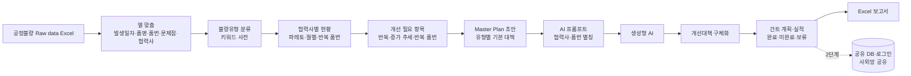

# 협력사 별 공정불량 분석 및 품질개선 Master Plan 관리 시스템 — 프로젝트 기획서

| 항목 | 내용 |
|---|---|
| 리포 | data10-07 |
| 제출자 | 이준호 |
| 직무·소속 | 부품품질팀 (회사명 생략) |
| 과정 | 현장 데이터 디지털화 전문가과정 2차수 |
| 작성일 | 2026-10-20 |
| 문서 상태 | 초안 v0.1 — 수강생 제출 자료 기반 |

---

## 1. 추진 배경과 현안

- 부품품질팀은 협력사에서 생기는 공정불량을 협력사별로 분석하고, 품질개선 Master Plan 을 세워 추진 상황을 관리해야 합니다.
- 공정불량 데이터(발생일자·품명·품번·문제점·협력사)는 Excel 로 쌓이고 있지만, 불량유형 분류·발생 현황 집계·개선 필요 항목 도출을 손으로 하고 있는 것으로 보입니다(가정).
- 개선대책·담당부서·추진 일정을 정해 Master Plan 을 만들고, 그 계획과 실적을 주차별로 따라가며 보고서로 내는 일도 따로따로 이루어지는 것으로 보입니다(가정).
- 가능하면 사외망에서도 접속해 볼 수 있기를 바랍니다.

## 2. 목표

### 2.1 최종 목표

- 공정불량 Raw data 를 올리면 **협력사별 불량유형 분류·발생 현황·주요 개선 필요 항목**이 자동으로 나오는 시스템
- 불량유형별 **개선대책·담당부서·추진 일정 초안을 AI 가 작성**하는 Master Plan 자동 생성
- **간트차트**로 연·월·주차별 개선일정을 보고, 담당자가 계획·실적과 **완료·미완료·보류** 상태를 적는 관리
- 확정한 Master Plan 과 개선대책 상세를 **보고서 형식 Excel** 로 출력
- 사외망 접속, 팀·협력사 공유 (장기)

### 2.2 1차 개발 목표

실제 Raw data 와 분류 기준을 받기 전이라, 1차는 **가상 데이터로 흐름 전체가 도는 브라우저 도구**를 만듭니다.

- Excel 업로드(열 자동 맞춤) → 키워드 사전으로 불량유형 분류 → 협력사별 현황·개선 필요 항목(규칙)
- 불량유형별 기본 대책으로 Master Plan 초안 → AI 프롬프트로 구체화(반자동)
- 주차·월 간트차트, 오른쪽 칸에서 계획·실적 입력, 상태별 색, 계획 확정 기록
- Excel 보고서(요약 · Master Plan · 개선대책 상세 · 불량 상세 · 확정 이력)

## 3. 보유 데이터

| 데이터 | 형태 | 규모·주기 | 비고(민감도 등) |
|---|---|---|---|
| 협력사 공정불량 DATA | Excel 로 가정 | 건수·기간 미상 | 열: 발생일자, 품명, 품번, 문제점, 협력사 (제출 원문). 1행 = 불량 1건으로 가정. 협력사명·품번은 사내 정보 — 외부 AI 에 보낼 때 가림 |
| 불량유형 분류 기준 | 미상 | — | 코드표가 있는지, 문제점 글만 있는지 미상 (10장 ②) |
| 담당부서 목록 | 미상 | — | 대책 담당부서로 쓸 목록 (10장 ②) |
| 현재 Excel 보고서 양식 | Excel 로 가정 | — | 보고서 출력 양식을 맞추기 위해 필요 (10장 ③) |

제출 원문에 Raw data 첨부는 없습니다(시안 화면 캡처만 있음). 1단계는 협력사 A~F 의 가상 데이터로 만들고, 실제 파일을 받으면 열 연결과 분류 사전만 맞춥니다.

## 4. 해결 방안 개요

| 단계 | 내용 |
|---|---|
| 수집 | 협력사 공정불량 Raw data Excel (매월 또는 수시 업로드로 가정) |
| 정리 | 열 이름이 달라도 자동 연결, 같은 행(발생일자+협력사+품번+문제점)은 한 번만 |
| 분석 | 문제점 글 → 불량유형(키워드 사전, 사람이 고친 값 우선), 협력사×유형 집계, 파레토, 월별 추이, 반복 품번 |
| 판단 | 개선 필요 항목 규칙 — 반복 발생 · 증가 추세 · 반복 품번 (기준값은 사용자 설정) |
| AI | 계산된 사실만 담은 프롬프트로 유형별 개선대책·담당부서·일정 초안 요청, 답을 표로 읽어 계획에 반영 |
| 산출물 | 대시보드, 불량 분석 화면, Master Plan 간트, 추진현황, Excel 보고서 |

## 5. 주요 기능

| 기능 | 설명 | 우선순위 |
|---|---|---|
| Raw data 업로드 | Excel·CSV 를 브라우저에서 읽고 열을 자동 연결. 틀리면 직접 고르고, 고른 연결은 다음 파일에 다시 씀 | MVP |
| 불량유형 분류 | 문제점 글에 든 키워드로 유형을 나눔. 사전은 설정에서 고치고, 행마다 사람이 고른 유형이 먼저 | MVP |
| 협력사별 발생 현황 | 건수, 유형 파레토, 월별 추이, 협력사×유형 교차표, 반복 품번 | MVP |
| 개선 필요 항목 도출 | 반복 발생·증가 추세·반복 품번 규칙과 근거 숫자 | MVP |
| Master Plan 초안 | 개선 필요 유형마다 기본 대책(대책·담당부서·시작 주·기간)으로 초안 | MVP |
| AI 개선대책 구체화 | 사실만 담은 프롬프트(협력사·품번은 별칭) → 답 붙여 넣기 → 표로 읽어 반영. 선택: OpenAI 호환 서버로 자동 보내기 | MVP(반자동) |
| 간트 계획·실적 관리 | 주차·월 칸, 계획/실적 막대, 상태별 색(완료 녹색·미완료 주황·보류 보라), 오른쪽 칸에서 담당자·일정·실적 입력 | MVP |
| 계획 확정 | 확정본을 버전으로 남기고, 확정 뒤 계획이 바뀌면 표시 | MVP |
| Excel 보고서 | 요약 · Master Plan(주차 칸) · 개선대책 상세 · 불량 상세 · 확정 이력 | MVP (양식은 10장 ③ 받은 뒤 맞춤) |
| 사외망 접속·공유 | 로그인, 팀·협력사 공유 DB, 협력사별 권한 | 확장(2단계) |
| 협력사 품질 포털 | 같은 수강생의 과제 02(APQP 서류 정합성 검증)와 한 포털의 메뉴로 묶기 | 확장(2단계) |

## 6. 기대 산출물

1. **공정불량 분석 도구(브라우저)** — 업로드, 유형 분류, 협력사별 현황, 개선 필요 항목
2. **Master Plan 초안과 AI 구체화** — 유형별 개선대책·담당부서·추진 일정
3. **간트차트 계획·실적 관리** — 주차·월 보기, 상태별 색, 계획 확정 기록
4. **Excel 보고서** — 확정 Master Plan 과 개선대책 상세
5. **공유·사외망 접속** — 2단계

## 7. 기술 구성

| 과정 도구 | 이 프로젝트에서 쓰는 곳 |
|---|---|
| 암묵지 자산화·전략기획 | 불량유형 분류 기준, 「개선이 필요하다」고 보는 기준, 유형별 표준 대책과 담당부서를 꺼내 적기 |
| 코랩(Python)·바이브코딩 | Raw data 정리, 분류·집계 규칙 시험, 브라우저 도구 제작 — 1단계의 중심 |
| 생성형 AI | 유형별 개선대책 초안 구체화 (1단계는 프롬프트 복사 반자동, 선택적으로 자동 보내기) |
| RAG·자동화 | 과거 개선대책서를 근거로 한 대책 추천, 지연 알림 (확장) |

**개발 형태(권장)**

- 1단계는 **설치 없이 브라우저에서 도는 정적 웹 도구**입니다. Excel 을 브라우저 안에서만 읽고 계산하므로 협력사 공정불량 데이터가 밖으로 나가지 않습니다. 분류·집계·규칙·간트는 AI 없이 동작합니다.
- AI 에는 **도구가 계산한 사실만** 보내고, **협력사 이름과 품번은 「업체1」「품목1」 같은 별칭으로 가립니다(기본).** 대응표는 브라우저에만 있고, AI 답의 별칭은 원래 이름으로 되돌립니다.
- **사외망**: GitHub Pages 에 올린 도구는 사외망·휴대폰에서도 열립니다. 다만 데이터는 각 브라우저에만 저장되므로, 여러 사람이 같은 Master Plan 을 보려면 2단계의 공유 DB(Supabase)와 로그인이 필요합니다. 협력사도 보는지에 따라 권한 설계가 달라집니다(10장 ④).

## 8. 개발 단계

### 1단계 — 지금 바로 개발 가능한 부분

Raw data 가 없어도 **제출 원문의 열 5개(발생일자·품명·품번·문제점·협력사)만으로** 흐름 전체를 만들 수 있습니다. 가상 데이터로 먼저 만들고, 실제 파일을 받으면 열 연결·분류 사전·규칙 기준만 맞춥니다.

- Excel·CSV 업로드, 열 자동 연결·직접 고르기, 같은 행 건너뛰기
- 키워드 사전 기반 불량유형 분류(설정에서 고침), 행별 직접 지정
- 협력사별 건수·유형 파레토·월별 추이·협력사×유형 교차표·반복 품번
- 개선 필요 항목 규칙(반복 발생·증가 추세·반복 품번, 기준값 사용자 설정)
- 유형별 기본 대책으로 Master Plan 초안, AI 프롬프트(별칭 가리기) → 답 읽기 → 반영
- 주차·월 간트, 오른쪽 칸 계획·실적 입력, 완료·미완료·보류 색, 계획 확정 버전
- 추진현황(전체 협력사, 지연 표시), Excel 보고서 5시트, JSON 백업
- 가상 데이터에는 일부러 증가 추세(협력사 C 용접 균열)·반복 품번·미분류 문제점을 넣어 규칙이 제대로 잡는지 확인합니다.

### 2단계

- 실제 Raw data 로 열 연결·분류 사전 보정, 불량유형 코드표·담당부서 목록 반영
- 현재 Excel 보고서 양식에 맞춘 출력
- 공유 DB(Supabase)와 로그인 — 사외망에서 팀이 같은 Master Plan 을 보고 실적 입력, 협력사 접속 시 자기 협력사만 보기
- **협력사 품질 포털**: 같은 수강생의 과제 02(APQP 서류 정합성 검증)와 함께 한 포털의 메뉴로 묶기(협력사 → 공정불량·개선계획 / APQP 서류)
- 지연 활동 알림

### 3단계

- 과거 개선대책서·유효성 결과를 근거로 한 대책 추천(RAG)
- 사내 허용 AI 와 직접 연결해 초안 자동 생성

## 9. 기대 효과

- **분석 시간 단축** — 업로드하면 협력사별 유형 분류·현황·개선 필요 항목이 바로 나옵니다.
- **우선순위 일관화** — 같은 규칙으로 반복·증가 추세·반복 품번을 빠짐없이 드러냅니다.
- **계획 수립 부담 감소** — 유형별 기본 대책과 AI 초안에서 시작합니다.
- **추진 관리 가시화** — 간트와 상태 색으로 지연·보류가 한눈에 보이고, 확정본과 보고서가 같은 데이터에서 나옵니다.

제출 자료에는 정량 수치가 없어 이 문서도 수치를 적지 않습니다.

## 10. 수강생 확인 목록

패들릿 댓글로 요청드린 것입니다. 받으면 1단계 도구의 열 연결·사전·보고서를 맞춥니다.

1. **Raw data 엑셀 20~30행** — 실제 열 이름·시트 구성·날짜 표기를 확인합니다. 협력사명·품번은 가려서 보내셔도 됩니다.
2. **불량유형 분류 기준(코드표)과 담당부서 목록** — 코드표가 있으면 키워드 사전 대신 그대로 씁니다. 문제점 글만 있다면 지금처럼 키워드로 나눕니다.
3. **지금 쓰시는 Excel 보고서 양식** — 확정 Master Plan 보고서를 같은 칸 배치로 내보냅니다.
4. **사외망 접속 조건** — 팀 안에서만 보는지, 협력사도 접속해 자기 계획·실적을 적는지. 회사 보안 규정상 외부 클라우드(DB)에 협력사 공정불량을 둘 수 있는지.

추가로 확인하고 싶은 것(답을 받으면 반영):

5. 「개선이 필요하다」고 보는 기준(지금 시작값: 기간 안 같은 유형 5건 이상 · 최근 3개월이 직전 3개월보다 50% 이상 늘고 3건 이상 · 같은 품번 3건 이상)
6. 외부 AI(ChatGPT 등) 사용 허용 여부, 사내 허용 AI 가 있는지

## 부록. 제출 원문 요약

| 출처 | 파일·게시물 | 내용 |
|---|---|---|
| 패들릿 게시물 (2차수) | 「협력사 별 공정불량 분석 및 품질개선 Master Plan 관리 시스템 구축」 — `docs/source/패들릿_접수_원문.md` | 직무·소속(부품품질팀), 현안(Master Plan 수립·관리 시스템, 사외망 접속), 보유 데이터(공정불량 DATA: 발생일자·품명·품번·문제점·협력사), 기대 산출물 4종(공정불량 자동 분석, Master Plan 자동 생성, 간트 계획·실적 관리, Excel 보고서 출력) |
| 첨부 | 수강생 시안 화면 「Quality Planner — Supplier Quality Intelligence」 | 왼쪽 메뉴 6개, MASTER PLAN 화면(조건·지표 6개·AI 요약 칩·통합 개선대책 Gantt·상태 범례·버튼 4개·오른쪽 입력 칸). 1단계 화면 구성을 이 시안에 맞췄습니다 |
| 같은 수강생 | 과제 02 — APQP 서류 정합성 검증 | 별도 리포. 2단계에서 협력사 품질 포털의 메뉴로 묶을 수 있음 |
