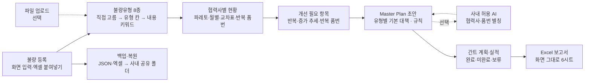

# 협력사 별 공정불량 분석 및 품질개선 Master Plan 관리 시스템 — 프로젝트 기획서

| 항목 | 내용 |
|---|---|
| 리포 | data10-07 |
| 제출자 | 이준호 |
| 직무·소속 | 부품품질팀 (회사명 생략) |
| 과정 | 현장 데이터 디지털화 전문가과정 2차수 |
| 작성일 | 2026-10-20 (v0.2 갱신 2026-10-21) |
| 문서 상태 | v0.2 — 수강생 답변(10장) 반영, 반영 내용은 11장 |

---

## 1. 추진 배경과 현안

- 부품품질팀은 협력사에서 생기는 공정불량을 협력사별로 분석하고, 품질개선 Master Plan 을 세워 추진 상황을 관리해야 합니다.
- 공정불량 데이터(발생일자·품명·품번·문제점·협력사)는 Excel 로 쌓이고 있지만, 불량유형 분류·발생 현황 집계·개선 필요 항목 도출을 손으로 하고 있는 것으로 보입니다(가정).
- 개선대책·담당부서·추진 일정을 정해 Master Plan 을 만들고, 그 계획과 실적을 주차별로 따라가며 보고서로 내는 일도 따로따로 이루어지는 것으로 보입니다(가정).
- 처음에는 사외망 접속도 바랐으나, 답변(10장 ④)에서 **사내망에서만 쓰기로** 정했습니다.
- 공정불량 Raw data 파일을 올리기는 어렵다는 답(10장 ①)에 따라, **화면에서 바로 입력하거나 엑셀 표를 붙여 넣는 방식**을 기본으로 합니다.

## 2. 목표

### 2.1 최종 목표

- 공정불량을 **화면에서 등록하거나 엑셀 표를 붙여 넣으면** 협력사별 불량유형(8종) 분류·발생 현황·주요 개선 필요 항목이 자동으로 나오는 시스템
- 불량유형별 **개선대책·담당부서·추진 일정 초안을 규칙(기본 대책)으로 작성**하고, 사내 허용 AI 가 있으면 다듬는 Master Plan 자동 생성
- **간트차트**로 연·월·주차별 개선일정을 보고, 담당자가 계획·실적과 **완료·미완료·보류** 상태를 적는 관리
- 웹 화면의 표·Master Plan·간트를 **그대로의 모양으로 Excel** 출력
- **사내망 전용** — 외부 서버·인터넷 없이 동작

### 2.2 1차 개발 목표

실제 Raw data 와 분류 기준을 받기 전이라, 1차는 **가상 데이터로 흐름 전체가 도는 브라우저 도구**를 만듭니다.

- Excel 업로드(열 자동 맞춤) → 키워드 사전으로 불량유형 분류 → 협력사별 현황·개선 필요 항목(규칙)
- 불량유형별 기본 대책으로 Master Plan 초안 → AI 프롬프트로 구체화(반자동)
- 주차·월 간트차트, 오른쪽 칸에서 계획·실적 입력, 상태별 색, 계획 확정 기록
- Excel 보고서(요약 · Master Plan · 개선대책 상세 · 불량 상세 · 확정 이력)

## 3. 보유 데이터

| 데이터 | 형태 | 규모·주기 | 비고(민감도 등) |
|---|---|---|---|
| 협력사 공정불량 DATA | 화면 입력·엑셀 붙여넣기 (파일 업로드는 어렵다는 답, 10장 ①) | 건수·기간 미상 | 칸: 발생일자, 협력사, 품번, 품명, 불량유형, 내용, 수량, 조치. 1행 = 불량 1건. 협력사명·품번은 사내 정보 — AI 에 보낼 때 별칭으로 가림 |
| 불량유형 분류 기준 | 8종 (10장 ②) | — | 위치/치수 · 간섭/정렬 · 이종/누락 · 용접불량 · 누유/누수 · 미조임 · 성능이상 · 기타 |
| 담당부서 목록 | 미상 | — | 대책 담당부서로 쓸 목록 — 지금은 가정(부품품질팀·협력사·구매팀·생산기술팀·설계팀) |
| Excel 보고서 양식 | 별도 양식 없음 (10장 ③) | — | 웹에 구성된 화면 그대로 Excel 로 출력 |

실제 자료는 받지 않습니다. 예시는 협력사 A~F 의 가상 데이터이고, 현장에서는 화면에 바로 입력합니다.

## 4. 해결 방안 개요

| 단계 | 내용 |
|---|---|
| 수집 | 「불량 등록」 화면에서 한 건씩 입력하거나 엑셀 표를 복사해 붙여 넣기 (파일 업로드는 선택) |
| 정리 | 붙여넣기는 열 이름으로 맞추고(없으면 정한 순서), 같은 줄(발생일자+협력사+품번+내용)은 한 번만. 화면 등록은 그대로 더함 |
| 분석 | 불량유형 8종 — ① 등록 때 고른 유형 ② 붙여 넣은 표의 유형 칸 ③ 내용 키워드 순. 협력사×유형 집계, 파레토, 월별 추이, 반복 품번 |
| 판단 | 개선 필요 항목 규칙 — 반복 발생 · 증가 추세 · 반복 품번 (기준값은 사용자 설정) |
| 계획 | 유형별 기본 대책으로 초안(규칙) → 직접 다듬기. 사내 허용 AI 가 있으면 계산된 사실만 담은 프롬프트로 다듬기(선택) |
| 산출물 | 대시보드, 불량 분석, Master Plan 간트, 추진현황, 화면과 같은 모양의 Excel 보고서 |

## 5. 주요 기능

| 기능 | 설명 | 우선순위 |
|---|---|---|
| 불량 등록 | 발생일자·협력사·품번·품명·불량유형(8종)·내용·수량·조치를 화면에서 입력. 수정·지우기, 거르기·찾기 | MVP (2차) |
| 엑셀 붙여넣기 | 엑셀에서 복사한 표를 붙여 넣으면 열 이름(또는 정한 순서)으로 읽어 미리 보고 넣기 | MVP (2차) |
| 백업·복원 | JSON(전부)·엑셀(불량 목록) 백업과 복원 — 사내 공유 폴더로 주고받기 | MVP (2차) |
| 파일 업로드 | Excel·CSV 를 브라우저에서 읽고 열을 자동 연결 (파일이 있을 때만) | 선택 |
| 불량유형 분류 | 8종. 고른 유형 → 유형 칸 → 내용 키워드 순. 사전은 설정에서 고침 | MVP |
| 협력사별 발생 현황 | 건수, 유형 파레토, 월별 추이, 협력사×유형 교차표, 반복 품번 | MVP |
| 개선 필요 항목 도출 | 반복 발생·증가 추세·반복 품번 규칙과 근거 숫자 | MVP |
| Master Plan 초안 | 개선 필요 유형마다 기본 대책(대책·담당부서·시작 주·기간)으로 초안 | MVP |
| AI 개선대책 다듬기 | 사내 허용 AI 가 있을 때만. 사실만 담은 프롬프트(협력사·품번은 별칭) → 답 붙여 넣기 → 표로 읽어 반영. 선택: 사내 OpenAI 호환 서버로 자동 보내기 | 선택 |
| 간트 계획·실적 관리 | 주차·월 칸, 계획/실적 막대, 상태별 색(완료 녹색·미완료 주황·보류 보라), 오른쪽 칸에서 담당자·일정·실적 입력 | MVP |
| 계획 확정 | 확정본을 버전으로 남기고, 확정 뒤 계획이 바뀌면 표시 | MVP |
| Excel 보고서 | 화면 그대로 6시트 — 요약 · 불량 목록 · 유형별·협력사별 집계 · Master Plan · 간트 일정 · 확정 이력. 머리글 굵게·열 폭·날짜 형식·상태 색·틀 고정 | MVP (2차) |
| 사내망 사용 | 외부 서버·CDN 없이 동작, 폴더째 사내 공유 드라이브·사내 웹서버에 두고 index.html 열기 | MVP (2차) |

## 6. 기대 산출물

1. **공정불량 등록·분석 도구(브라우저)** — 화면 입력·붙여넣기, 불량유형 8종 분류, 협력사별 현황, 개선 필요 항목
2. **Master Plan 초안** — 유형별 개선대책·담당부서·추진 일정(규칙), 사내 허용 AI 로 다듬기(선택)
3. **간트차트 계획·실적 관리** — 주차·월 보기, 상태별 색, 계획 확정 기록
4. **Excel 보고서** — 화면과 같은 모양의 6시트
5. **사내망 배포 안내** — 폴더째 두고 index.html 열기, 백업 파일로 공유

## 7. 기술 구성

| 과정 도구 | 이 프로젝트에서 쓰는 곳 |
|---|---|
| 암묵지 자산화·전략기획 | 불량유형 분류 기준, 「개선이 필요하다」고 보는 기준, 유형별 표준 대책과 담당부서를 꺼내 적기 |
| 코랩(Python)·바이브코딩 | Raw data 정리, 분류·집계 규칙 시험, 브라우저 도구 제작 — 1단계의 중심 |
| 생성형 AI | 유형별 개선대책 초안 구체화 (1단계는 프롬프트 복사 반자동, 선택적으로 자동 보내기) |
| RAG·자동화 | 과거 개선대책서를 근거로 한 대책 추천, 지연 알림 (확장) |

**개발 형태(권장)**

- **설치 없이 브라우저에서 도는 정적 웹 도구**입니다. 입력·분류·집계·규칙·간트·Excel 출력이 모두 브라우저 안에서 끝나고, 외부 서버·CDN 을 부르지 않습니다(엑셀 읽기·쓰기 SheetJS 도 폴더 안 `vendor/`). AI 없이 전부 동작합니다.
- **사내망 배포**: 폴더를 통째로 사내 공유 드라이브나 사내 웹서버의 정적 폴더에 두고 `index.html` 을 엽니다. 데이터는 각 PC 브라우저에만 저장되므로, 팀이 같은 자료를 보려면 「백업·복원」의 JSON·엑셀 파일을 사내 공유 폴더로 주고받습니다. 공유 DB·로그인은 외부 클라우드가 필요해 사내망 전용 조건(10장 ④)에서는 두지 않습니다.
- **AI 는 선택**입니다. 사내에서 쓰도록 허용된 AI 가 있을 때만 쓰고, 그때도 **도구가 계산한 사실만** 보내며 **협력사 이름과 품번은 「업체1」「품목1」 같은 별칭으로 가립니다(기본).** 대응표는 브라우저에만 있고, AI 답의 별칭은 원래 이름으로 되돌립니다.

## 8. 개발 단계

### 1단계 — 가상 데이터로 흐름 전체 (2026-10-20, 완료)

- Excel·CSV 업로드, 열 자동 연결·직접 고르기, 같은 행 건너뛰기
- 키워드 사전 기반 불량유형 분류, 협력사별 건수·파레토·월별 추이·교차표·반복 품번, 개선 필요 항목 규칙
- 유형별 기본 대책으로 Master Plan 초안, AI 프롬프트(별칭 가리기) → 답 읽기 → 반영
- 주차·월 간트, 오른쪽 칸 계획·실적 입력, 상태 색, 계획 확정 버전, 추진현황, Excel 보고서, JSON 백업

### 2차 반영 — 수강생 답변 (2026-10-21, 완료, 11장)

- **불량 등록 화면**(한 건씩 입력·수정·지우기)과 **엑셀 붙여넣기**를 기본 경로로, 파일 업로드는 선택
- 불량유형 **8종**으로 교체(사전·키워드·기본 대책·차트·보고서·예시 데이터), 1단계 데이터는 열 때 8종으로 옮김
- **화면 그대로의 Excel 6시트**와 서식(머리글 굵게·열 폭·날짜 형식·상태 색·틀 고정·거르기)
- **사내망 전용** — 외부 요청 0건 확인, AI 는 사내 허용 AI 가 있을 때만 쓰는 선택 기능, 사내망 배포 방법 안내
- 백업·복원(JSON·엑셀)

### 다음 — 현장 입력으로 다듬기

- 실제로 입력해 보며 불량유형 키워드(자동 분류가 틀리는 표현)·기본 대책·담당부서 목록 보정
- 개선 필요 항목 기준값 확인(10장 ⑤)
- 사내 허용 AI 가 정해지면 그 주소로 자동 보내기 연결 확인

## 9. 기대 효과

- **분석 시간 단축** — 입력하거나 붙여 넣으면 협력사별 유형 분류·현황·개선 필요 항목이 바로 나옵니다.
- **우선순위 일관화** — 같은 규칙으로 반복·증가 추세·반복 품번을 빠짐없이 드러냅니다.
- **계획 수립 부담 감소** — 유형별 기본 대책 초안에서 시작합니다.
- **추진 관리 가시화** — 간트와 상태 색으로 지연·보류가 한눈에 보이고, 화면과 Excel 보고서가 같은 데이터·같은 모양으로 나옵니다.

제출 자료에는 정량 수치가 없어 이 문서도 수치를 적지 않습니다.

## 10. 수강생 확인 목록

패들릿 댓글로 요청드린 것과 받은 답입니다(2026-10-21). 반영 내용은 11장에 있습니다.

| 번호 | 요청한 것 | 받은 답 | 반영 |
|---|---|---|---|
| ① | Raw data 엑셀 20~30행 | 데이터 파일 업로드는 어려울 것 같습니다. | 화면 입력·엑셀 붙여넣기를 기본 경로로, 업로드는 선택 |
| ② | 불량유형 분류 기준과 담당부서 목록 | 1) 위치/치수 2) 간섭/정렬 3) 이종/누락 4) 용접불량 5) 누유/누수 6) 미조임 7) 성능이상 8) 기타 | 기본 사전 8종으로 교체. 담당부서 목록은 답이 없어 가정 유지 |
| ③ | 지금 쓰시는 Excel 보고서 양식 | 별도 Excel 보고 양식은 없습니다. 웹에 구성된 양식 그대로 Excel 형식으로 출력만 되면 좋겠습니다. | 화면 그대로 6시트 + 서식 |
| ④ | 사외망 접속 조건·외부 클라우드 가능 여부 | 사내망에서만 사용하려고 합니다. | 외부 요청 없이 동작, 사내망 배포 안내, AI 는 사내 허용 AI 가 있을 때만 |
| — | (과제 02 와의 관계) | 위 프로젝트만 유지하고, 2번 프로젝트(APQP Smart Review)는 드랍하겠습니다. | 「02·07 협력사 품질 포털로 묶기」 계획 삭제 |

남은 확인(다음 회차에 여쭐 것):

5. 「개선이 필요하다」고 보는 기준 — 지금 시작값: 기간 안 같은 유형 5건 이상 · 최근 3개월이 직전 3개월보다 50% 이상 늘고 3건 이상 · 같은 품번 3건 이상
6. 대책 담당부서 목록 — 지금 가정: 부품품질팀 · 협력사 · 구매팀 · 생산기술팀 · 설계팀
7. 사내에서 쓰도록 허용된 AI 가 있는지(있다면 OpenAI 호환 주소로 열려 있는지) — 없으면 규칙 초안만 씁니다
8. 도장·외관·녹 같은 불량은 「기타」로 두었습니다 — 따로 나누는 유형이 있는지

## 11. 2차 반영 내용 (v0.2, 2026-10-21)

| 답변 | 바꾼 것 | 확인한 것 |
|---|---|---|
| ① 업로드 어려움 | 왼쪽 메뉴 맨 위에 **「불량 등록」**: 한 건씩 등록(발생일자·협력사·품번·품명·불량유형·수량·내용·조치, 유형을 비우면 내용 키워드로 자동 분류 — 입력 중 미리 보임, 발생일자·협력사는 다음 건을 위해 남김), **엑셀 붙여넣기**(머리행이 있으면 열 이름으로, 없으면 「발생일자·협력사·품번·품명·불량유형·내용·수량·조치」 순서, 칸 안 줄바꿈 처리, 미리 보기 후 넣기), 등록된 불량 거르기·찾기·수정·지우기, **백업·복원**(JSON 전부 · 엑셀 불량 목록 · 입력 양식 .xlsx). 업로드는 「파일 업로드 (선택)」로 남김. 엑셀 열 이름에 「불량유형」「조치」를 더함 | 테스트: 붙여넣기 순서·머리행·따옴표 칸, 입력 점검, 엑셀 백업 → 다시 읽기 같음. 브라우저: 등록 2건 · 붙여넣기 2건 · 수정 · 엑셀 백업 4건 |
| ② 불량유형 8종 | 기본 사전·키워드·기본 대책을 8종으로. 분류 순서 = 직접 고른 유형 → 붙여 넣은 표의 유형 칸(「위치·치수」「용접 불량」처럼 띄어쓰기·구분 기호가 달라도 맞춤) → 내용 키워드. 도장·외관·녹은 「기타」 키워드. AI 답의 유형 이름도 같은 방식으로 맞춤. 1단계 9종으로 저장된 브라우저 데이터는 열 때 8종으로 옮김(이름을 고친 사전은 그대로) | 테스트: 8종 순서·유형별 대표 문장 분류·옮기기. 예시 데이터 신호(협력사 C 용접불량 증가, A 이종/누락·TP-1102, D 위치/치수·TP-4405) |
| ③ 웹 양식 그대로 Excel | 보고서 6시트 = 요약 · 불량 목록 · 유형별·협력사별 집계(파레토·협력사별·교차표 8종 순서·개선 필요 항목) · Master Plan · 간트 일정(월/주차 두 줄 머리, ○ 계획 연한 파랑 · ● 실적 상태 색) · 확정 이력. 머리글 굵게·회색 바탕·테두리, 열 폭, 날짜는 엑셀 날짜(yyyy-mm-dd), 틀 고정, 거르기, 상태 칸 색. Master Plan 이 없는 협력사도 불량 목록·집계는 나옴 | 테스트: 시트·머리·칸 값, 만든 xlsx 를 다시 열어 굵은 글꼴·색·날짜 형식·틀 고정 확인(서식 붙이기를 일부러 끄면 실패). openpyxl 로도 열어 확인 |
| ④ 사내망 전용 | 외부 서버·CDN 없이 동작(SheetJS 는 vendor/), 설정에 「사내망에서 쓰기」 안내, AI 칸은 접어 두고 「사내 허용 AI 가 있을 때만」, AI 서버 고르기에서 외부 서비스 바로 고르기 삭제, Master Plan 초안은 규칙(기본 대책) | 브라우저 점검에서 외부 주소 요청 0건(일부러 외부 이미지를 부르면 잡히는 것 확인) |
| ⑤ 02 드랍 | 「02·07 협력사 품질 포털로 묶기」 계획 삭제 | — |

## 부록. 제출 원문 요약

| 출처 | 파일·게시물 | 내용 |
|---|---|---|
| 패들릿 게시물 (2차수) | 「협력사 별 공정불량 분석 및 품질개선 Master Plan 관리 시스템 구축」 — `docs/source/패들릿_접수_원문.md` | 직무·소속(부품품질팀), 현안(Master Plan 수립·관리 시스템, 사외망 접속), 보유 데이터(공정불량 DATA: 발생일자·품명·품번·문제점·협력사), 기대 산출물 4종(공정불량 자동 분석, Master Plan 자동 생성, 간트 계획·실적 관리, Excel 보고서 출력) |
| 첨부 | 수강생 시안 화면 「Quality Planner — Supplier Quality Intelligence」 | 왼쪽 메뉴 6개, MASTER PLAN 화면(조건·지표 6개·AI 요약 칩·통합 개선대책 Gantt·상태 범례·버튼 4개·오른쪽 입력 칸). 1단계 화면 구성을 이 시안에 맞췄습니다 |
